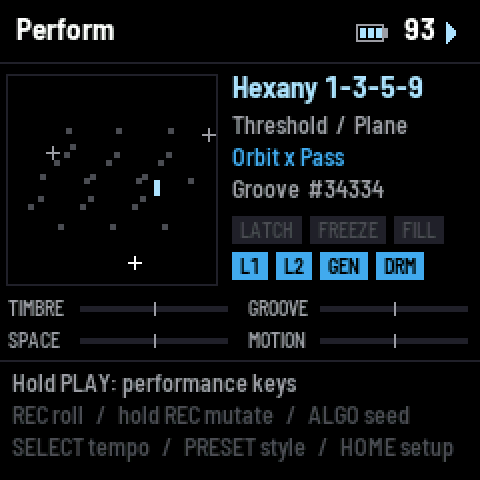

# MANIFOLD

**Generative just-intonation firmware for the M-VAVE FM-1.** Nothing is sequenced.



MANIFOLD turns the FM-1 into a self-playing instrument. Two layers of moving points wander over a map of a
just-intonation scale (a Tonnetz: neighbours are fifths, thirds and sevenths), and every note they pass near sounds,
as loud as the points near it. The rhythm is one continuous function of the bar, the drums ride the synth's own notes,
and every partial is in tune with its note (its harmonics, and undertones below it). Four performance knobs steer it; the keys play into it.

- **Play it in the browser:** [stets43.github.io/Manifold/emu](https://stets43.github.io/Manifold/emu/), the whole
  firmware in WebAssembly on a drawn FM-1 (the build is in [`emu/`](emu/)).
- **Install:** the web installer on the [MANIFOLD site](https://stets43.github.io/Manifold/) (Chrome or Edge), or
  [`firmware/manifold-1.0.5.fwsc`](firmware/) with fm1-base's `tools/fm1_install.py`.
- **User guide:** [docs/MANUAL.md](docs/MANUAL.md), also [on the site](https://stets43.github.io/Manifold/manual/).
  It covers every page and setting, and ends with the mathematics of each generator for developers.

## What is in it

- **41 scales** in just intonation: the harmonic series, handpan and tongue-drum tunings (the 1-3-5-9 hexany, Golden
  Gate, Celtic minor, Kurd…), pentatonics, modes. Temper moves them continuously to 12-tone equal temperament.
- **Twelve motions** for the points: Orbit (Lissajous), Ladder, Swarm (Kuramoto), Lorenz, Motif, Drift, Billiard
  (Sinai), Gravity, Stride, Loops (coprime tape loops), Erode, Chords. **Eight envelopes**: Pulse, Swell, Speed, Pass,
  Height, Hold, Stream, Drums. Either layer can move, add to or gate the other instead of playing.
- **Voices** of 13 exact harmonics and three undertones a note (an octave, two and three below: in tune), shaped by
  one continuous spectral function (tone, tilt, centre, band, stride, phase law, bloom, detune, width), with odd/even
  colour, pluck, depth and per-octave clarity. Each layer's **Balance** spreads its loudness evenly over the notes'
  range, or toward the bass or the middle.
- **A rhythm without a grid**: a stream of smooth peaks with continuous swing, three-against-four, fineness, rotation
  and long form; a threshold or a coupled-oscillator engine; four drums that put envelopes and colour on notes the synth
  already plays, never changing pitch, either linear or playing patterns from a library trained on real house, techno,
  breakbeat, drum'n'bass and hip-hop.
- **A 24-route modulation matrix** with six LFOs, the knobs, the generators' own motion and more as sources, and the
  performance knobs as destinations.
- **Effects**: fuzz, morphing filter, tempo delay, an 8-line reverb that can be tuned to the scale or frozen, bus
  compressor, look-ahead limiter.
- Rolls in eight styles, locks, undo, 64 patches in four banks with four scenes each, MIDI in and out over USB and
  Bluetooth (MPE out, in just intonation), Bluetooth audio out to headphones and speakers.

## Releases

- **1.0.6** (in testing): **MIDI out** of what MANIFOLD plays, over USB and Bluetooth MIDI, only while something
  listens: the layers' notes (started and stopped at a floor under each layer's peak, at most 24 new notes a second a
  layer by default), the keys, the drums (a General MIDI kit, or pitched), the knobs as CC 21–24 and the clock.
  **MPE** sends each note on its own channel with the pitch bend that puts it at its exact just pitch. Latch and
  Panic no longer leave notes hanging on the receiver. **Dry patches**: a quarter of the rolls (or FX → Output → Dry)
  have no fuzz, filter, delay or reverb, not run at all (about 40 % less work in the simulator), and the Space knob becomes **Shape**:
  the drums' envelopes as a kit (the kick and tom bloom, the snare and hat stay tight), the layers' contour, the
  voices' pluck, width and spin, the duck and the compressor's attack, over a wide range with the drums' loudness held roughly steady; Pump goes to Groove. The drums' levels ride Groove
  (±4 dB) and the layers' levels Motion (±3 dB, opposite) in every patch. **Drum notes, Follow … Fixed** (on Groove): from the drums riding the motion's notes
  to a kit at pitches after the 808's (kick 45–76 Hz, tom 90–185, snare 200–320, hat at the top), each on a sounding
  note in its band or else the scale's nearest, with its own spectrum (body, crack, sizzle); between, the bands widen.
  The kit sits lower under the kick (snare −8 dB, tom −6, hat −13) and the hats are closed (20–60 ms). Bluetooth audio: each of a device's audio inputs is asked for
  SBC in turn (one offering AAC or its own codec first was refused); a device holding an old pairing with the FM-1 is
  answered "key missing" as the spec has it, and a re-pairing it stops part way is given up after 8 s, the crash
  report saying why.
- **1.0.5** (2026-11-18): drum **patterns** beside linear drumming: a library trained on about 100 house, techno,
  breakbeat, drum'n'bass and hip-hop patterns, played without a grid (swing bends them, Density thins them, fills,
  ghosts, rotation, polymetric loop lengths, mutes), rolled by a decision tree over the corpus. New styles **House**
  (replacing Drum circle) and **Hip-hop** (replacing Tongue drum); **Breakbeat** rebuilt (mostly 124–140 BPM, a third
  drum'n'bass). Wider tempos in every style; Ambient, Cosmic and Wild down to sparse, slow, evolving; a deeper,
  richer matrix in every roll (no self-feedback routes); Machine modulates its own rhythm. **Keys pull the points**
  (Layer 1 → Keys): off, a key plays just its note. The keys play both layers by default. **Harder drums**: a hit's
  Bright and Snap act at full strength however loud the note is (no longer by the hit's share of it), Snap past Wave's
  top with a length Settle sets, and rolls give the kick's duck more depth. A drum's **Bright** tilts by the octave at the
  note's energy (brighter, not louder). Each layer's new **Colour** page: **Odd / even** (hollow ↔ even-rich) and
  **Pluck** (the upper partials fade first after a note rises); at their defaults the sound is as before. Each drum
  can pluck the note it hits and push its Odd / even; all of it rolled per style and on the Timbre and Groove knobs. **Undertones**: each note has
  harmonics 1–13 and its undertones an octave, two and three below (in tune), by the new **Depth**; nothing low is
  cut (nothing under 20 Hz is played). **Clarity** limits how many partials each octave holds across the notes, the
  low ones fewest, so the bass is deep and the chords stay clear (and it saves CPU). A drum's **Bright** goes both ways: Dark
  tilts its hit toward the undertones (a kick's or tom's fall, without a pitch sweep), Bright toward the top, at half
  the old range, the fundamental never more than 6 dB down; on the Timbre knob. Wave's harmonics now sit under Tone. **The reverb** no
  longer folds its top back into the tail (a 9 kHz input low-pass), its Damp really darkens the tail (now on the Space
  knob, rolled darker), and its tails decay as set (their 16-bit lines were truncated, which cut them short). **Reverb Size** moves without clicks (turned or modulated). Each layer's **Balance** (Layer → Notes): the motions
  visit some notes more than others, and a table trained per motion divides that out (Balanced: every note of the
  range about equally), or leans it toward the bass (Dark) or the middle (Bright); rolled per style, on the Timbre knob.
  The bass voicing rule is retired. Rolls span **4–6 octaves** (six most often, where the scale's notes allow). Older patches load with the
  patterns off; 1.0.4 cannot read patches saved by 1.0.5.
- **1.0.4** (2026-11-13): 64 patch slots in four banks (A–D) of 16. A tap on SAVE shows the Patches page (the
  banks, the active bank's slots); SAVE + key and HOME + key use the active bank; the settings are kept with
  SAVE + OCT+ or K4 on that page, no longer with a SAVE tap. 1.0's 16 slots become bank A. After 1.0.4, do not go
  back to an earlier version (it would miss some patches and the Bluetooth speakers).
- **1.0.3** (2026-11-12): FM-1s with the newer UC25HQ80 flash (JEDEC `B36014`, units sold since autumn 2026) are
  recognised alongside the Puya P25Q80 (`856014`). Before, those units kept nothing between power-ons (patches,
  settings, Bluetooth devices). Nothing else changed.
- **1.0.2** (2026-11-12): Bluetooth audio to speakers that set up the stream themselves after pairing (1.0 refused
  them); the set-up's steps on the crash report's log; the SBC encoder set up from each connection's agreement.
  The sound engine is unchanged.
- **1.0** (2026-11-10): first release.

## Building

MANIFOLD is an app on [fm1-base](https://github.com/charlesvestal/fm1-base). It needs a few changes to fm1-base
(a larger RAM code window, and the battery read in the key scan's pot slot); they are in [`patches/`](patches/).

```
git clone --recursive https://github.com/charlesvestal/fm1-base
cd fm1-base
git checkout 2d8ed74 && (cd bsp && git checkout 773b0b9)
git apply ../Manifold/patches/fm1-base.patch
(cd bsp && git apply ../../Manifold/patches/felucca-bsp.patch)

python3 tools/build.py ../Manifold --host              # the host simulator (any Linux or macOS)
../Manifold/build/host/manifold_host ../Manifold/tests/basic.txt ../Manifold/build/host

tools/get_toolchain.sh                                     # JieLi's clang for the FM-1
export JIELI_TOOLCHAIN=~/.jieli/toolchain AC79_SDK=/path/to/fw-AC79_AIoT_SDK
python3 tools/build.py ../Manifold --release 1.0.5     # -> build/manifold-1.0.5.fwsc
```

The device build needs three files from JieLi's AC79 SDK V1.2.1 (`cpu/wl82/tools/uboot.boot`, `cfg_tool.bin`,
`cfg/eq_cfg_hw.bin`; Apache-2.0), checked by SHA-256. `tests/basic.txt` runs 144 checks in the simulator and
`tests/midi.txt` MIDI out's (`tools/midi_check.py` checks its log: every note-on its note-off, the rate cap);
`tests/screens.txt` and `tests/guide.txt` make the screenshots. `tools/site.py` builds the website (the front page in
`site/`, the manual, fm1-base's web installer and the firmware).

## Layout

```
app.c, app.h, fm1.toml    the app: pages, performance keys, scenes, patches, MIDI, Bluetooth audio
midi_out.h                MIDI out: the layers' notes, keys, drums, knobs, clock; Standard and MPE
dsp/gen.c                 the twelve motions, the eight envelopes, routes, keys, the drive
dsp/rhythm.c              the stream, events, drum choice, the Lock engine
dsp/drums.c               drum triggers, envelopes and character, on the synth's voices
dsp/voice.c               the oscillator banks and their spectral function
dsp/engine.c, scales.c    the surfaces, the Tonnetz layout, tuning, the scale library
dsp/mod.c                 LFOs, the matrix, the knobs' paths
dsp/fx.c                  effects; dsp/params.c parameters, rolls, styles; dsp/synth.c the top level
docs/MANUAL.md            the user guide;  site/  the website's front page
firmware/                 the release and the licence texts that ship with it
emu/                      the firmware compiled for the browser (tools/emcc-zig: no Emscripten needed)
```

## Licence

MANIFOLD is [MPL-2.0](LICENSE). It is built on fm1-base by Charles Vestal (MPL-2.0), which carries code by Leo
Kuroshita (Felucca), Chris Farrell and others (see fm1-base's LICENSING.md). The firmware uses fm1-base's own Bluetooth
stack, which includes Apache-2.0 and BSD-2-Clause code: their texts are in [`firmware/`](firmware/). The screen font is
Barlow Semi Condensed (SIL OFL 1.1). M-VAVE and FM-1 are trademarks of their owners; this project is not affiliated
with M-VAVE.
