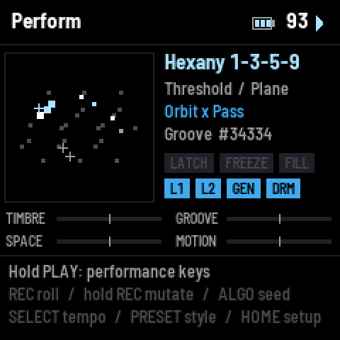
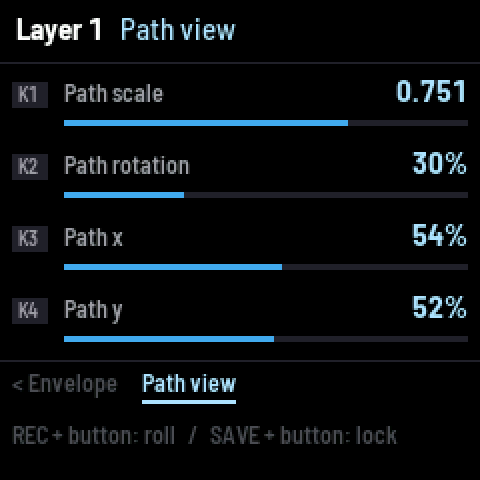
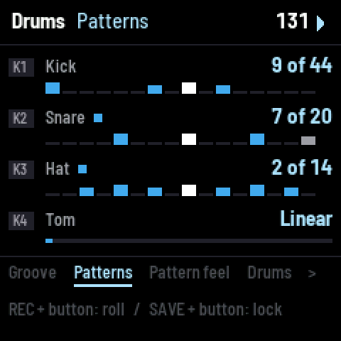
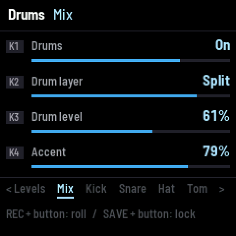
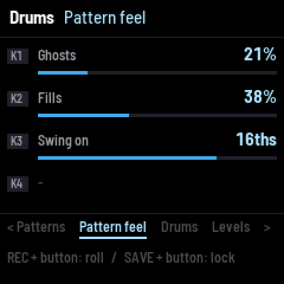
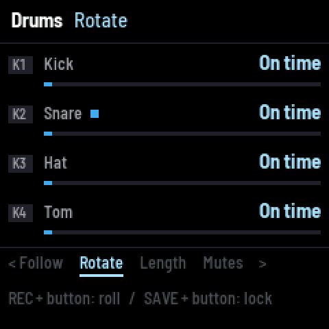
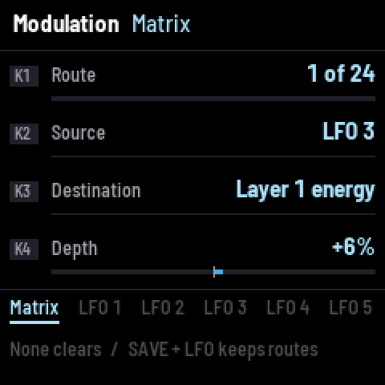
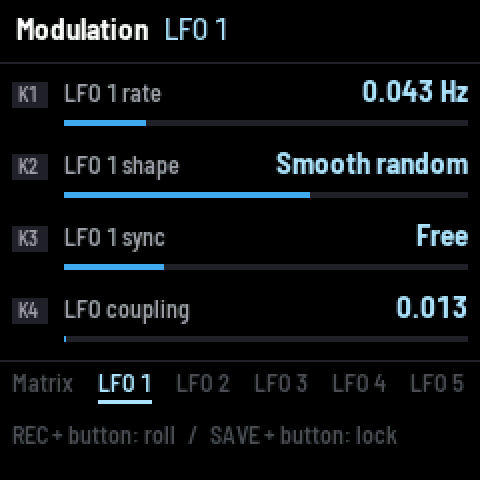
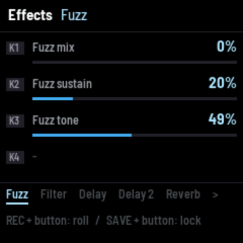
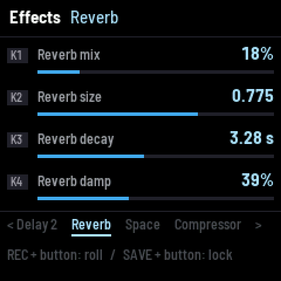

# MANIFOLD — User Guide

**Generative just-intonation firmware for the M-VAVE FM-1**


MANIFOLD turns the FM-1 into a self-playing instrument. Two **layers** of moving points wander over a map of a
scale, and every note they pass near sounds, as loud as the points near it. Nothing is sequenced: there are no steps,
no patterns and no note triggers. The motion is continuous, the loudness is continuous, and the rhythm is a
continuous landscape the motion is shaded by. You steer it with four performance knobs, play into it with the keys,
roll new patches with one button, and dig into every part of it from the page buttons.

Everything is in tune in a strict sense. Every note is a whole-number ratio of the scale's root (just intonation),
and every partial of every note is a whole-number multiple of that note, so chords fuse instead of beating.

This guide covers installing the firmware, playing it, and every page and setting. The last part,
[For developers](#for-developers), gives the mathematics of each generator and how the code is organised.

---

## Contents

1. Install
2. Quick start
3. How MANIFOLD thinks
4. The screen
5. Controls at a glance
6. The Perform page
7. Playing the keys
8. Rolls, styles, locks and undo
9. Patches and scenes
10. Scale (SEL)
11. Voice 1 and Voice 2 (ENV and GLO)
12. Layer 1 and Layer 2 (EDIT and ARP)
13. Drums and rhythm (SEQ)
14. Modulation (LFO)
15. Effects (FX)
16. Setup (HOME twice)
17. MIDI
18. Bluetooth audio
19. Recipes
20. Troubleshooting
21. For developers

---

## Install

MANIFOLD is a single firmware file, `manifold-VERSION.fwsc`. Installing it replaces the FM-1's current firmware;
you can go back to the stock firmware or any other FM-1 firmware the same way.

**From the web installer** (Chrome or Edge, desktop):

1. Connect the FM-1 to the computer with a USB data cable and switch it on.
2. Open the installer page on the MANIFOLD site and press **Connect**. Pick the FM-1 when the browser asks.
3. Press **Install** and wait for it to finish. The FM-1 restarts into MANIFOLD.

**From the command line** (with [fm1-base](https://github.com/charlesvestal/fm1-base) checked out):

```
python3 tools/fm1_install.py manifold-VERSION.fwsc
```

**Try it first in the browser.** The MANIFOLD site has the whole firmware running in WebAssembly on a drawn FM-1
(the *emu* page): click the buttons, drag the knobs, play the keys with the mouse or the computer keyboard. It
sounds the same as the FM-1, and patches you store there are kept in the browser.

**After installing**, the FM-1 starts on a fresh patch every time: a Groove-style roll on the 1-3-5-9 hexany with
its root on A1. It is silent until you press PLAY (the keys play at once).

---

## Quick start

1. **Press PLAY.** The two layers start moving and the patch plays itself. PLAY again stops it.
2. **Turn K1–K4** on the Perform page. These are the performance knobs: **Timbre**, **Groove**, **Space** and
   **Motion**. Each one moves a dozen or more settings at once along its own path; the centre is the patch as rolled.
3. **Play the keys.** A key sounds its note and pulls the moving points toward it, so the music bends around what
   you play and lets go when you release.
4. **Tap REC** for a new sound (the scale stays). **Double-tap REC** to roll everything.
5. **Turn PRESET** to choose a style (Wild, Hip-hop, Groove, Ambient, Cosmic, House, Machine, Breakbeat); it
   rolls a new patch in that style once the knob rests.
6. **Hold SAVE and press a key (1–16)** to store the patch. **Hold HOME and press the key** to load it again. A tap
   on **SAVE** shows the Patches page: four banks of 16.
7. **Hold PLAY** to see the performance keys: scenes, tap tempo, fill, freeze, latch, mutes, undo and panic.

That is enough to play. The rest of this guide explains what each part does, so you can shape it.

---

## How MANIFOLD thinks

### The scale is a map

The notes of the scale are laid out like a tongue drum: the root (the **ding**) and the scale's notes over one to
six octaves. Each note has a place on a **Tonnetz**, a map where neighbours are consonant: fifths run along one
axis, major thirds at 60°, natural sevenths at −60°. On the Perform page this map is the square on the left; each
small square is a note.

### Two layers of moving points

Each **layer** is a **generator**: one to eight **points** that move across the map along a **motion** (a
continuous function of time: an orbit, a chaotic flow, a run up the scale, a chord progression…). Each point also
carries an **envelope**, a loudness that changes continuously (a pulse, a swell, its own speed, the rhythm…).

A note sounds as loud as the points near it, weighted by their envelopes. A point sitting on a note is that note; a
point between two notes sounds both, crossfaded; a point crossing the map glides from note to note. **Reach** sets
how far a point's influence spreads.

Layer 1 is drawn as crosses, layer 2 as dots. The layers can also act on each other instead of both playing (see
[Route](#route-one-layer-shaping-the-other)).

### Each layer has a voice

Every sounding note is a bank of up to 16 oscillators at exact harmonics of the note. A layer's **voice** (Voice 1,
Voice 2) is one smooth function that sets all their levels and phases from a few controls: where the spectrum
peaks, its slope, its stride, its phase pattern. Anything can move these while notes ring and the tone follows
without a seam.

### The rhythm is a landscape, not a grid

There is no step sequencer. The rhythm is a **stream**: a sum of smooth peaks at the bar, the half bar, the beat and
faster divisions (in twos, in threes, or both). It shades every envelope (Grip) and its peaks above a threshold are
**events** that the **drums** play. Swing, three-against-four, rotation and long-form variation are all continuous
controls on that one function.

### The drums ride the synth

The four drums (kick, snare, hat, tom) make no sound of their own and never change a note's pitch. A hit puts an
envelope and a change of colour (brighter, snappier) on a note that the synth is already playing. So the drums are
always in tune and always part of the same sound.

---

## The screen


Every page has the same three parts.

**Header.** The page's name and the part of it you are on. On the right: the **tempo** in BPM and the **transport**
(a triangle while it runs, a square when stopped), plus **BT** while Bluetooth audio streams. On the Perform page, a
**battery** gauge sits left of the tempo: 0–3 bars, amber at one bar or none, or **USB** when a computer powers the
FM-1. When you change something, its name and new value show in the header for a moment.

**Middle.** Four rows, one for each knob, K1 at the top. Each row shows the setting's name, its value in real units
(Hz, ms, BPM, notes, names) and a bar. A dash means the knob does nothing on this tab.

**Footer.** The page's tabs; **SELECT** moves between them (the underlined one is shown). Below them, a reminder of
what the buttons do on this page.

**Color themes.** Nine: Glacier, Ember, Moss, Rose, Violet, Sunset, Lagoon, Gold and Mono (Setup → General → K1).

---

## Controls at a glance

### Knobs

| Control | On the Perform page | On any other page |
| --- | --- | --- |
| K1–K4 | the performance knobs: Timbre, Groove, Space, Motion | the four rows of the tab shown |
| SELECT | tempo (one BPM a detent) | the tabs |
| PRESET | choose a style and roll a patch in it (once the knob rests) | same |
| ALGO | the next / previous seed: a new patch, the same one every time for a given seed | same |

### Page buttons

| Button | Opens | What is there |
| --- | --- | --- |
| HOME | Perform (from Perform: Setup) | the map, the knobs, what is playing |
| SEL | Scale | scale, rotation, root, octaves; temper, surface |
| ENV | Voice 1 | layer 1's sound |
| EDIT | Layer 1 | layer 1's motion, points, envelope, path view |
| SEQ | Drums | the rhythm and the four drums |
| ARP | Layer 2 | layer 2's motion, points, envelope |
| LFO | Modulation | the modulation matrix, LFO 1–6 |
| FX | Effects | fuzz, filter, delay, reverb, compressor, output |
| GLO | Voice 2 | layer 2's sound |

### Buttons and gestures

| Gesture | Does |
| --- | --- |
| PLAY (tap) | start / stop the generators and the rhythm (the keys always play) |
| PLAY (hold) | the performance keys appear on the white keys (see below) |
| REC (tap) | roll the sound: both voices, both layers, the rhythm and the drums (never the scale, effects or knobs) |
| REC (double tap) | roll everything except the scale |
| REC (hold 0.7 s) | mutate: a small nudge to every continuous setting |
| REC + a page button | roll only that page (REC + FX or REC + LFO: the matrix, the LFOs and the effects together) |
| REC + HOME | roll the performance knobs' paths |
| REC + SEL | roll the scale (the only way a roll changes it) |
| SAVE (tap) | the Patches page: the banks and their slots (tap again: back to the page you were on) |
| SAVE + a page button | lock / unlock that page: rolls leave a locked page alone |
| SAVE + HOME | lock / unlock the performance knobs |
| SAVE + key 1–16 | store the patch in that slot of the active bank |
| HOME + key 1–16 | load the patch in that slot of the active bank |
| SAVE + OCT+ | keep the settings (theme, octave, MIDI, Bluetooth, load, keys); SAVE + OCT− does nothing |
| OCT − / OCT + | move the keys down / up a scale period (−3 to +3); on the Patches page, choose the bank |

---

## The Perform page


**The map** (left). Every note of the scale where it sits on the surface. A note lights up as it sounds (brighter is
louder; a held key is white and larger). Layer 1's points are crosses, layer 2's are dots; each is brighter while
its envelope is up.

**What is playing** (right, top to bottom):

- the **scale**;
- the rhythm's **engine** (Threshold or Lock) and the **surface** (Plane, Torus, Sphere);
- the **layers**: "Orbit / Drift" when both play; when one layer shapes the other, the carrier and how it is
  shaped: "Lorenz x Pass" (multiplies), "Lorenz + Pass" (adds), "Ladder on Orbit" (moves);
- the **style** and the **seed** (#34334), or the **patch** number if one is loaded.

**Chips.** LATCH, FREEZE and FILL light while those performance keys are on. L1, L2, GEN and DRM are lit while
layer 1, layer 2, the generators and the drums are on (DRM also flashes on each hit).

**The performance knobs** (bottom). Four bipolar bars. The centre is the patch as rolled.


### The performance knobs

Each knob rides a **path** through most of the settings of its part of the instrument. Turning it does not just
scale one value: every setting on the path goes its own way, and the half-way point can lean somewhere different
from the end, so a full turn is a journey through several different sounds. The header shows how many settings ride
the knob as you turn it.

| Knob | Part of the instrument | Always on its path |
| --- | --- | --- |
| **Timbre** | both voices | Tone, Center, Band and Tilt of the voices |
| **Groove** | the rhythm and the drums | Density, Swing; in a genre style, each pattern (to its busier or sparser relatives, a few lines along the library) |
| **Space** | the effects | filter cutoff and resonance, reverb mix, size and decay, delay send and feedback |
| **Motion** | both layers, the path view and the LFOs, the patterns' rotations and fills | layer 1's Rate and Reach; in a genre style, often the hat's and the fourth part's rotation (by 8ths) |

Levels (layer levels, drum levels, master) and Temper are never on a knob. **REC + HOME** rolls new paths; **SAVE +
HOME** locks them so rolls keep them. The knobs can also be turned by the modulation matrix: see
[Knobs as destinations](#knobs-as-destinations). A white tick on a knob's bar shows where the matrix has it.

### The performance keys


Hold **PLAY**: the white keys become the performance keys and the screen shows the map. Let go of PLAY to return.

| White key | Does |
| --- | --- |
| 1–4 | **Scenes 1–4**: tap to recall (a 1.2 s morph); hold a second to store the current sound in it |
| 5 | **Tap** tempo: from the second tap, averaged over the last four; a pause of over 2 s starts again (so taps reach down to 30 BPM; SELECT goes to 10) |
| 6 | **Fill**: both layers' energy up while held |
| 7 | **Freeze**: the reverb holds what it has, forever, until pressed again |
| 8 | **Latch**: keys stay on after you let go (press a latched key again to release it) |
| 9 | mute / unmute **Layer 1** |
| 10 | mute / unmute **Layer 2** |
| 11 | mute / unmute the **Generators** (the keys still play) |
| 12 | **Drums** on / off |
| 13 | **Undo** the last roll, mutation or seed |
| 14 | **Panic**: everything off |
| 15 | **Drum keys**: the keys play the drums, and back |

---

## Playing the keys



**The keys play the scale, not the chromatic keyboard.** Key 1 is a low note of the scale and each key up is the next
note of the scale in pitch order, so every key is in tune with the patch. OCT − and OCT + shift the keys by a scale
period (−3 to +3).

**A key is an input into the system, not a note-on.** Pressing a key sounds its note directly (with the key's
velocity) and **pulls the layer's points toward that note** over about 0.15 s, so the motion bends around what you
play; it lets go when you release. The patch's own envelope shapes the key's note: a sharp Contour gives a struck
note (fast rise and fall), a soft one a bowed note (slow rise, long hold, slow release). While the generators run, a
held key also breathes with the layer's envelope.

**Which layer the keys play** is set in Setup → Keys: Layer 1, Layer 2, Both layers (the default since 1.0.5), or
Drums. **Whether a key pulls the moving points** toward its note is the patch's own setting (Layer 1 → Keys): off,
a key plays exactly its note, for melodic lines.

**Drum keys** (performance key 15, or Keys play → Drums): each key plays one of the four drums (kick, snare, hat,
tom, repeating up the keys) at its velocity. The hit rides a note the drum layer is playing, as rhythm hits do.

**Latch** (performance key 8) holds every key you press until you press it again.

---

## Rolls, styles, locks and undo

A **roll** makes a new patch from a random **seed**, shaped by the current **style**. The same seed and style always
give the same patch.

| Style | Character |
| --- | --- |
| **Wild** | everything anywhere: the whole range of every setting (45–165 BPM); a quarter of the rolls take genre patterns too |
| **Hip-hop** | Groove's sound with boom-bap drums from the [patterns](#patterns): heavily swung 16ths, syncopated kicks, the snare on 2 and 4, about 62–100 BPM, a long deep kick, short hats |
| **Groove** | rhythmic and bright, runs and loops on the beat, drums on most of the time (80–132 BPM) |
| **Ambient** | slow, soft, wide; swells and drifts, down to a single slow note; drums rarely (40–90 BPM) |
| **Cosmic** | strange scales and combs, passing motions, anything from sparse and slow to dense (60–135 BPM) |
| **House** | Groove's sound with house and techno patterns: the kick on every beat, the clap on 2 and 4, off-beat and 16th hats, percussion against the bar (115–140 BPM) |
| **Machine** | Groove's sound with an IDM rhythm: drums always on, the matrix moving the rhythm's own controls hard (80–170 BPM) |
| **Breakbeat** | Groove's sound with the classic breaks: syncopated kicks, ghosted snares, mostly 124–140 BPM, a third of the rolls drum'n'bass at 160–178 |

House, Hip-hop and Breakbeat build their drums from a **pattern library trained on about 100 genre patterns** (see
[Patterns](#patterns)). Each roll walks a decision tree through the corpus: a kick, then a snare that goes with that
kick, then hats that go with both, then the swing those hats are played with. Most rolls are combinations the corpus
never has, but they keep its rules: in 60 rolls of each, the snare lands on 2 and 4 in 92–96 % of bars and House's kick
is on every beat in 89 %.

**The matrix in rolls.** Every curated style rolls 3–10 routes (Machine up to 14) to a wide list of musical places
(the voices, the motions, the path, the rhythm, the drums, the effects), deep enough to be heard, each limited so
nothing shuts or runs away. A route that would feed a layer back into itself (its own envelope moving its own path)
is never rolled. The genre styles sometimes route a slow LFO or the bar's random to a pattern, so it walks among its
relatives.

**What a roll changes:**

- **REC (tap)** rolls the sound: both voices, both layers, the rhythm and the drums.
- **REC (double tap)** rolls everything but the scale: the sound, the matrix, the LFOs, the effects and the knobs.
- **REC + a page button** rolls only that page. **REC + SEL** is the only roll that changes the scale.
- **PRESET** rolls everything in the chosen style; **ALGO** steps through seeds.
- **REC (hold)** mutates: every continuous setting moves a little from where it is.

**Locks.** Hold **SAVE** and press a page button to lock that page: rolls and mutations leave it alone. The header
shows LOCKED on a locked page. Lock the scale, a voice you like, or the matrix (SAVE + LFO) and keep rolling the
rest.

**Undo.** Performance key 13 undoes the last roll, mutation or seed change.

**Morphs.** A roll glides into the new patch (about 1.5 s; 0.3 s in Wild) instead of jumping. Settings that rebuild
the map (scale, rotation, root, octaves, surface) cause a short silence of about 15 ms.

---

## Patches and scenes


**Patches.** 64 slots: four banks (A–D) of 16, one slot per key. **SAVE + key** stores everything in that slot of
the active bank: every setting, the matrix, the knobs' paths and positions, the locks and the four scenes. **HOME +
key** loads it. While SAVE or HOME is held, the keys that hold a patch in the active bank light up. The Perform page
shows "patch B5" while a loaded patch is unchanged by rolls. If a patch was the last thing you loaded, it comes back
at power-on, with its bank active; otherwise the FM-1 starts on a fresh roll.

**The Patches page.** A tap on **SAVE** opens it; another tap goes back to the page you were on (HOME and the page
buttons leave it too). It shows the four banks with how many patches each holds, and the active bank's 16 slots:
a stored patch lit, the one playing bright.

| On the Patches page | |
|---|---|
| K1, or OCT − / OCT + | choose the bank (A–D) |
| SAVE + key 1–16 | store in that slot of the bank shown |
| HOME + key 1–16 | load from it |
| K4 (turn right) | keep the settings; the row says "unsaved" when there is something to keep |

The bank stays active when you leave the page, so SAVE + key and HOME + key work on it from any page. Storing over a
slot that holds a patch replaces it, without asking.

**Patches and firmware updates.** Updates keep the patches and the settings. 1.0.4 moved the patches into a shared
area of the flash to make room for 64: the 16 slots of earlier versions become bank A by themselves at the first
power-on. Do not go back to a version before 1.0.4 afterwards: it would miss some patches and forget the Bluetooth
speakers, and storing a patch there could overwrite others.

**Patches from before 1.0.5** load as they were: the patterns' settings are new and arrive off (every drum Linear),
with the keys' pull on. A patch saved by 1.0.5 is in a newer format that 1.0.4 cannot read (it shows those slots as
Empty), so stay on 1.0.5 or later once you have saved with it.

**Scenes.** Four snapshots inside the current patch, on performance keys 1–4. **Hold** a scene key for a second to
store the current sound; **tap** it to recall, with a 1.2 s morph. Scenes are saved with the patch.

**Settings** (theme, key octave, MIDI channel and output, Bluetooth, load caps, keys, the style) are kept with
**SAVE + OCT+** (hold SAVE first), or K4 on the Patches page. The SAVE button lights while there are changes not kept
yet; without keeping them, the next power-on brings back the settings as they were. Storing a patch keeps them too.

---

## Scale (SEL)

 

| Tab | Knob | Setting | Range | What it does |
| --- | --- | --- | --- | --- |
| Tuning | K1 | **Scale** | 41 scales | the set of notes (below) |
| | K2 | **Rotation (the ding)** | each note of the scale | which note is the root: the same notes, another mode (named "/2", "/3"…) |
| | K3 | **Root** | A0–A3 | the ding's pitch |
| | K4 | **Octaves** | 1–6 | how far the scale extends above the ding |
| Temper & surface | K1 | **Temper** | Just … Equal (12-tone) | moves every note continuously from its just ratio to the nearest equal-tempered pitch, to play along with other instruments |
| | K2 | **Surface** | Plane, Torus, Sphere | the shape of the map: the plane reflects at its edges, the torus wraps around, the sphere has no edge (a path over a pole comes down the other side) |

Changes to Scale, Rotation, Root, Octaves and Surface take effect when the knob rests (about 0.3 s) and rebuild the
map (a moment of silence). Temper retunes without a rebuild.

**The 41 scales**, in five groups:

- **Harmonic**: Harmonic series (the ding's partials 1, 2, 3…, not folded into an octave), Odd harmonics,
  Harmonics 4-8, 6-12, 8-16, Harmonic pentatonic, Undertones 8-16.
- **Tongue drum and handpan**: Hexany 1-3-5-9, Golden Gate, Celtic minor (Amara), Kurd, Integral, Pygmy, Akebono,
  Sabye, Aegean, Hijaz.
- **Pentatonic and smaller**: Fifths, Suspended, Major pentatonic, Minor pentatonic, Egyptian, Septimal pentatonic,
  In, Kumoi.
- **Modes**: Major, Dorian, Phrygian, Lydian, Mixolydian, Minor, Harmonic minor, Melodic minor, Acoustic (overtone),
  Phrygian dominant, Double harmonic.
- **Other**: Blues, Major hexatonic, Whole tone, Diminished, Chromatic.

Every note is a whole-number ratio of the ding. Notes that hold the key more strongly (the ding, its fifth, its
third) have more **tonal weight**: the motions lean toward them. Low notes far from the ding are kept quieter in the
bass, as an arranger would voice them, so low chords stay clear.

---

## Voice 1 and Voice 2 (ENV and GLO)

  

Voice 1 is layer 1's sound, Voice 2 is layer 2's. Both pages are the same. Every note is up to 16 oscillators at the
note's exact harmonics; these settings shape all of them at once, live, and the sound is normalised so they change
the colour, not the volume.

| Tab | Knob | Setting | Range | What it does |
| --- | --- | --- | --- | --- |
| Tone | K1 | **Tone** | 250 Hz – 16 kHz | where the partials stop: above it they fall 24 dB an octave. Not a filter: each partial's level is set by its own frequency, so nothing rings |
| | K2 | **Tilt** | 0–100 % | the spectrum's slope: dark (k^−1.6) through a saw's slope (k^−1) to bright (k^−0.4) |
| | K3 | **Detune** | 0–100 % | doubles each note's first three partials with a copy up to 14 cents away (each note its own amount and side): slow beating and stereo movement. 0 = no copy |
| | K4 | **Wave** | 0–100 % | each oscillator from a sine to a richer wave (adds its own 2nd and 3rd harmonics) |
| Spectrum | K1 | **Center** | partial 1–12 | where a formant-like lift sits in the series (up to +9.5 dB once above the 5th partial) |
| | K2 | **Band** | 0–100 % | how wide that lift is |
| | K3 | **Stride** | every partial … every 4th | thins the spectrum: 2 = odd partials only (hollow, clarinet-like), 3 = every third… continuous between |
| | K4 | **Phase** | 0–100 % | the phase pattern across the partials: aligned (a sharp, buzzy pulse), Schroeder at 50 % (smooth, glassy), then dispersed (a twangy, stiff-string quality) |
| Voice | K1 | **Bloom** | 0–100 % | louder is brighter, note by note: quiet notes lose their upper partials |
| | K2 | **Width** | 0–100 % | stereo: each note is panned by its place on the map |
| | K3 | **Register** | Octave down, As tuned, Octave up | the whole layer an octave down or up |
| | K4 | **Layer level** | 0–100 % | the layer's volume |
| Colour | K1 | **Odd / even** | 0–100 % | the partials above the fundamental blended toward a square's (odd, falling 1/k: hollow, reedy) under 50 %, toward the even ones (octaves: nasal, organ-like) over it. 50 % is the bank as it is; the fundamental is never changed |
| | K2 | **Pluck** | Off … 100 % | after a note's level rises (or a drum hits it), its upper partials fade faster than the lower: the top first, as a plucked or struck string. Higher is faster (1.5 s … 25 ms). It also lightens the load: fewer partials sound |

A layer plays up to 8 notes at once (Setup → Load). When more want to sound, the quietest fade out over 8 ms; no
note is ever cut.

---

## Layer 1 and Layer 2 (EDIT and ARP)

 
 

The two layers are the same, except that **Path view** is on Layer 1's page and moves both.

| Tab | Knob | Setting | What it does |
| --- | --- | --- | --- |
| Motion | K1 | **Motion** | the function the points follow (12, below) |
| | K2 | **A** | the motion's first control (its name changes with the motion) |
| | K3 | **B** | the motion's second control |
| | K4 | **Rate** | how fast: cycles per bar, from 1 per 64 bars to 4 a bar, snapped to whole-number ratios so a repeating motion lines up with the rhythm |
| Points | K1 | **Points** | 1–8 points: how many notes the layer can sound at once |
| | K2 | **Spread** | how far apart the points are along the motion (0 = all together) |
| | K3 | **Reach** | how far a point's sound spreads to nearby notes: 0 = mostly the note it is on, 100 % = its neighbours at about half |
| | K4 | **Energy** | the layer's drive (also the depth when it shapes the other layer) |
| Envelope | K1 | **Envelope** | how each point's loudness moves (8, below) |
| | K2 | **Envelope rate** | for Pulse and Swell: 1 per 16 bars to 4 a beat (exact ratios to the bar). For Drums: which drum |
| | K3 | **Contour** | the envelope's shape: soft and broad … sharp and narrow |
| | K4 | **Route** | Plays, or shapes the other layer (below) |
| Path view | K1 | **Path scale** | how much of the map the motions cover (1.0 = all the notes) |
| | K2 | **Path rotation** | turns every motion on the map: a different set of neighbours along the same path |
| | K3, K4 | **Path x, Path y** | slides the motions across the map |
| Keys (Layer 1) | K1 | **Keys pull the points** | **On**: a key sounds its note and pulls the nearest point toward it (the music bends round what you play). **Off**: a key plays just its note, the points carry on around it: for melodic lines |


**Keys pull the points** is part of the patch, and rolls switch it off in a share of patches (half in the beat
styles). It applies to both layers.

When a motion's discrete choice changes (a ratio, a figure, the motion itself, the number of points), each point
glides from where it is onto the new path over about 0.3 s. A point never jumps.

### The twelve motions

| Motion | What you hear | A | B |
| --- | --- | --- | --- |
| **Orbit** | a closed loop (a Lissajous figure): an ostinato that returns every cycle | **Ratio** (1:1, 2:1, 3:2, 4:3, 5:4, 5:3, 3:1, 5:2): the figure | **Phase**: opens it from a line to a loop |
| **Ladder** | runs through the notes in pitch order, resting on each: scales and arpeggios by step | **Span**: 3–12 notes | **Contour**: up, up and down, down |
| **Swarm** | the points are coupled oscillators: they gather into a chord, then scatter | **Coupling**: how strongly they pull together | **Spread**: how different their speeds are |
| **Lorenz** | chaos with two lobes: circles one group of notes, then flips to the other | **Chaos** (ρ 20–50): how often it flips | **Zoom**: how much of the attractor fills the map |
| **Motif** | a small figure stated at the ding, again, answered away, then home (A A B A) | **Figure**: the figure's shape (a ratio) | **Answer**: at the fifth, at the third, or alternating |
| **Drift** | a smooth random walk: slow, aimless, never repeating | **Detail**: a finer wander on top | **Density**: how many turns a cycle |
| **Billiard** | straight runs that bounce off the edges and a central bumper: arpeggios that fold back | **Angle**: the heading (0–180°) | **Bumper**: its size; with it, the runs never repeat |
| **Gravity** | the point orbits the key's own notes, falling toward the ding, swinging round and away | **Wells**: the ding; ding and fifth; ding, fifth and third | **Energy**: low = tight orbits, high = wide swings |
| **Stride** | moves only as the rhythm's stream peaks and turns while it rests: a melody that steps with the beat | **Turn**: how much and which way it turns | **Stride**: how far each step goes |
| **Loops** | each point is a tape loop on its own note, of lengths 5, 7, 8, 11, 13, 17, 19, 23: they never line up twice | **Notes**: how many of the key's notes they share (2–6) | **Swell**: how long each note sounds in its loop |
| **Erode** | one six-note figure repeated, wearing away note by note (weakest first), then renewed | **Life**: passes until renewal (4–64) | **Wear**: how much of it is worn away |
| **Chords** | the points are a chord and the chord changes: harmonic rhythm, four chords a cycle | **Progression**: I IV V I, I VI IV V, I III IV II, I V VI IV, I I IV I, I VII VI V | **Voicing**: thirds, fourths, fifths |

### The eight envelopes

| Envelope | Loudness follows… | Contour |
| --- | --- | --- |
| **Pulse** | a periodic peak at Envelope rate, locked to the bar | soft swell … sharp attack and narrow peak (the steepest rise is still a few ms, never a click) |
| **Swell** | a periodic raised-cosine swell at Envelope rate | how narrow the swell is |
| **Speed** | the point's speed: loud while it moves, quiet while it rests | how steep |
| **Pass** | nearness to a note: it sounds as it passes through notes, silent between | how narrowly |
| **Height** | the motion's third dimension (a flow's height, the distance from the centre, the speed round a well) | how steep |
| **Hold** | steady (the motion alone shapes the music) | — |
| **Stream** | the rhythm's stream itself: it sounds where the drum events are | only the strongest events … all of them |
| **Drums** | a drum's envelope (Envelope rate picks kick, snare, hat, tom, or all) | how sharp |

Every envelope is also accented by the rhythm's stream, by the amount set with **Grip** (Drums → Lock & motion).

### Route: one layer shaping the other

With **Route** set to anything but Plays, a layer falls silent and acts on the other one instead. Its **Energy** is
the depth. Point *j* of the played layer takes point *j* of the shaping layer (wrapping around).

| Route | What it does | Example |
| --- | --- | --- |
| **Plays** | both layers sound | — |
| **Moves** | its path is added to the other's path | a Lissajous loop carried along a Lorenz orbit |
| **Adds to** | its envelope is added to the other's | Stream accents on a chaotic swell |
| **Multiplies** | its envelope gates the other's | a chaotic flow gated by a pulse |

If both layers are set to route, layer 2 shapes and layer 1 plays ("Plays (2 routes)").

---

## Drums and rhythm (SEQ)

The Drums page has 24 tabs. The first ones are the ones you reach for most.

   

### How the rhythm works

The rhythm is a **stream**: a smooth curve over the bar that peaks at the downbeat, the half bar and the beats, and
(depending on the Groove settings) at eighths, sixteenths, triplets or both. It never stops changing smoothly; there
is no grid.

- In the **Threshold** engine, every peak of the stream above a threshold is an **event** with a strength. **Density**
  sets the threshold. **Drum choice** decides which drum plays each event.
- In the **Lock** engine, each drum is its own oscillator at a whole-number rate (kick 2 a bar, snare 2 offset by
  half, hat 8, tom 3), slightly detuned, and **Pull** couples them back into step: strongly pulled they lock to the
  grid; loosely, they slip and catch again.

The stream also shapes the synth: **Grip** accents every envelope with it, and the **Stream** envelope and **Stride**
motion follow it.

### Patterns

Each drum can either take part in the choice above (**Linear**: one drum per event, MANIFOLD's own drumming) or
play a **pattern**: a line from a library trained on about 100 house, techno, breakbeat, drum'n'bass and hip-hop
patterns (44 kick lines, 20 snare, 14 hat, 17 percussion, each one or two bars of 16ths). The two live side by side,
a drum at a time: a patterned kick and snare with a linear hat and tom is the stream's own drumming over a genre
skeleton.

 
 

**It is not a step sequencer.** A pattern says where in the metre a drum plays; when is still the stream's:

- **Swing** bends the steps as it bends the stream (at the 16ths or the 8ths, **Swing on**): the second of each
  pair moves from half way to two thirds (triplet swing) to three quarters, continuously.
- **Density** thins a pattern from its weakest steps: a step sounds only if the stream without swing is strong enough
  at its place in the bar (the 16ths go first, then the off-beats; the downbeat last). Ghost notes need more.
- **Fills**: on the second half of every fourth bar, a drum may play a busier relative of its line instead.
- **Ghosts**: the patterned drums also take part in the linear choice, quietly: MANIFOLD's own fills between the
  pattern's hits.
- **Rotate** delays a line by 16ths (the hats moved by two are off-beat hats); **Length** loops it over its first
  2–32 steps against the bar (a 12-step percussion line over a 16-step bar drifts round it: polymeter).
- **Mutes**: a drum that plays mutes another on the same instant: the kick clearing the hat, an open hat (the fourth
  part) choking the closed one, the snare clearing the linear drums under it.

The library is ordered from sparse to busy, with similar lines next to each other, so turning a pattern (by hand, with
the Groove knob or from the matrix) moves to a close relative, never a random jump. A pattern moved by a knob or a
route never falls back to Linear; only setting it to Linear by hand does.

### All the drum settings

| Tab | Knob | Setting | What it does |
| --- | --- | --- | --- |
| **Groove** | K1 | **Density** | how many events: the threshold the stream must cross |
| | K2 | **Swing** | the off-beat's timing: straight (0 %), triplet swing (about 67 %), hard (100 %) |
| | K3 | **Threes** | twos (eighths, sixteenths) … 3 against 4 (50 %) … threes (triplets) |
| | K4 | **Fine** | how far the subdivisions go: beats only … sixteenths and thirty-seconds |
| **Patterns** | K1–K4 | **Kick, Snare, Hat, Tom** | Linear, or a line of the library (1 … its count): the strip under it shows the steps, the ghosts dimmer, the step playing now white |
| **Pattern feel** | K1 | **Ghosts** | how much the patterned drums also take the linear layer's events (quietly) |
| | K2 | **Fills** | how often the second half of a fourth bar plays a busier relative |
| | K3 | **Swing on** | the level Swing bends for the patterns: 8ths or 16ths |
| **Drums** | K1–K4 | **Kick, Snare, Hat, Tom** density | each drum's share of the events (0 = that drum off) |
| **Levels** | K1–K4 | **Kick, Snare, Hat, Tom** level | each drum's level (Off … 0 dB). A light by the name flashes on each hit |
| **Mix** | K1 | **Drums** | on / off |
| | K2 | **Drum layer** | which layer's notes the drums ride: Layer 1, Layer 2, or **Split** (kick and tom on the lower-sounding layer, snare and hat on the higher) |
| | K3 | **Drum level** | all the drums |
| | K4 | **Accent** | how much an event's strength sets the hit's velocity |
| **Kick / Snare / Hat / Tom** | K1 | **Voice** | which of the drum layer's sounding notes the hit rides: lowest note … highest note |
| | K2 | **Attack** | 1–20 ms |
| | K3 | **Decay** | 20 ms – 3 s (to −35 dB) |
| | K4 | **Curve** | the decay's shape: exponential … straight |
| **Rhythm** | K1 | **Tempo** | 10–180 BPM |
| | K2 | **Rhythm** | the engine: Threshold or Lock |
| | K3 | **Form** | long-form variation: slow functions move the threshold, the sixteenths, the three-feel and the drum choice, so the pattern evolves over many bars (with all of it, it repeats only after 6,720 bars) |
| | K4 | **Turn** | shifts the threes against the twos by up to a third of a bar: every rotation is a different rhythm |
| **Drum choice** | K1 | **Drum choice** | **Select**: each drum bids for each event by its strength (Place) and the selector; **Count**: hat on every event, kick every n-th, snare between kicks, tom on strong leftovers |
| | K2 | **Selector** | the selector's speed (Select): 1 per 2 bars … 3 a bar; it makes kick and snare answer each other |
| | K3 | **Feedback** | (Select) how much a drum that just played steps back for the others |
| | K4 | **Kick every** | (Count) the kick every 2–8 events |
| **Lock & motion** | K1 | **Pull** | (Lock) how strongly the drum oscillators lock to the grid |
| | K2 | **Motion** | layer 1's path moves the threshold: the melody makes the rhythm busier or sparser |
| | K3 | **Evolve** | a slow random wander of both layers' A and B (and looser Lock timing) |
| | K4 | **Grip** | how strongly the stream accents every synth envelope |
| **Hold** | K1–K4 | per drum | how long the envelope holds at full level after the attack (0–50 ms) |
| **Place** | K1–K4 | per drum | which events it prefers: Strongest … Weakest (kick strongest, hat weakest). When a drum follows a layer: which point it follows |
| **Shape & duck** | K1 | **Shape by** | None, Layer 1, Layer 2: every drum is multiplied by that layer's envelope, and its decays lengthen in a swell and shorten in a trough |
| | K2 | **Shape depth** | how much |
| | K3 | **Kick duck** | sidechain: the kick ducks the synth |
| **Follow** | K1–K4 | per drum | **The stream** (the rhythm decides), or **Layer 1 / Layer 2**: the drum fires when one point's envelope of that layer rises past 1 − its density. A silent, shaping layer works too. A drum with a pattern plays its pattern instead |
| **Rotate** | K1–K4 | per drum | its pattern delayed by 0–15 16ths |
| **Length** | K1–K4 | per drum | its pattern looped over its own length, or its first 2–32 steps |
| **Mutes** | K1–K4 | per drum | what it mutes on the instants it plays: Nothing, the kick, the snare, the hat, the tom, or the linear drums |
| **Kick / Snare / Hat / Tom sound** | K1 | **Bright** | the hit tilts the note's partials up at its start (up to +6 dB an octave, the note's energy kept: brighter, not louder), however loud the note already is |
| | K2 | **Settle** | how fast that brightness settles (300 ms … 9 ms) and how far |
| | K3 | **Snap** | a push on the voice's Wave at the hit, past Wave's own top: a bite on the attack. It lasts as Settle says: 71 ms at 0, 25 ms in the middle, 9 ms at full |

  

**The drums never change pitch.** A hit swells a note that is already sounding and colours it. The kick also lets
the note's fundamental through in full (normally partials under 90 Hz are softened), so it has weight. If the drum
layer is silent, the hit lands on the note under its loudest point.

With the drums on, the synth sits about 4 dB lower to make room.

---

## Modulation (LFO)

### The matrix

 

The first tab of the LFO page. **24 routes**, each a **source** onto a **destination** at a **depth**.

| Knob | Does |
| --- | --- |
| K1 **Route** | which route (1–24) you are editing ("empty" if unused) |
| K2 **Source** | what modulates. **None** clears the route |
| K3 **Destination** | what is modulated |
| K4 **Depth** | −100 % … +100 % of the destination's range (on a knob: of its full turn) |

A new route starts at +25 % onto the Timbre knob.

**Sources**

| Source | Range | What it is |
| --- | --- | --- |
| LFO 1–6 | −1 … +1 | the six LFOs |
| Timbre / Groove / Space / Motion knob | −1 … +1 | where your hand has the knob |
| Output level | 0 … 1 | the instrument's loudness (an envelope follower) |
| Layer 1 onsets | 0 … 1 | a pulse each time layer 1's notes rise |
| Random (a bar) | −1 … +1 | a new random value each bar, reached smoothly across the bar |
| Path X, Path Y | −1 … +1 | where layer 1's main point is on the map |
| Velocity | 0 … 1 | the last key's velocity |
| Layer 1 motion, Layer 2 motion | 0 … 1 | that layer's loudest point's envelope: the generators as modulators |

Sources marked 0 … 1 push one way only from where the destination is set: use a negative depth to pull it down.

**Destinations**, in this order: the four **performance knobs**, the **LFO rates**, **Layer 1** (with the path view),
**Layer 2**, **Voice 1**, **Voice 2**, the **drums**, the **rhythm**, and the **effects**. Names say where each one is:
"Kick decay", "LFO 3 rate", "Layer 2 rate", "Voice 1 tilt". Every continuous setting is there except the master level.

### Knobs as destinations

A route onto a knob turns that knob for you, so every setting on its path moves together, exactly as if a hand were
turning it. A white tick on the Perform page shows where the matrix has the knob. Your hand still sets the centre
the route moves around. Knob sources always read your hand, never the routed position, so knob → knob routes cannot
loop. Rolls never route onto the knobs.

### Generators as sources

**Layer 1 motion** and **Layer 2 motion** let the generators modulate anything: the drums' envelopes, a voice, an
effect, a knob. Rolls with the drums on often add one or two Motion → drum routes. Two things to know:

- A layer's motion routed onto **its own** generator (its rate, energy, reach…) or onto the Motion knob is a feedback
  loop. It is bounded and stable, but it can settle at an extreme (rate pinned high, say).
- A route onto a knob moves every setting on that knob's path at once.

**Rolls and the matrix.** Rolling the LFO page (or REC + FX, or a double tap) rewrites the matrix, and mutation nudges
its depths. **SAVE + LFO** locks it so your routes survive both.

### LFO 1–6



| Knob | Setting | Range | What it does |
| --- | --- | --- | --- |
| K1 | **Rate** | 0.01–12 Hz | speed |
| K2 | **Shape** | Sine, Triangle, Saw, Square, Step random, Smooth random, Chaos, Rhythm, Shape 9 | Chaos is a logistic map (a new value each cycle); Rhythm a fixed 8-step pattern; **Shape 9** follows the output level |
| K3 | **Sync** | Free, Tempo | Tempo snaps the rate to the nearest of 1/8 … 4 cycles a beat (just ratios: 1/3, 2/3, 3/4, 4/5, 5/4, 4/3, 3/2…) |
| K4 | **LFO coupling** | 0–2 (shared by all six) | the LFOs pull on each other's phases (Kuramoto coupling): at higher values they drift into step |

---

## Effects (FX)

 

The chain: **fuzz → filter → delay and reverb sends → compressor → master → limiter**.

| Tab | Knob | Setting | What it does |
| --- | --- | --- | --- |
| **Fuzz** | K1 | **Fuzz mix** | wet/dry (0 = bypassed) |
| | K2 | **Fuzz sustain** | drive (24–52 dB): a two-stage, Big-Muff-style fuzz on the whole mix. On a just scale its sum and difference tones land back on the harmonic series |
| | K3 | **Fuzz tone** | dark … scooped … bright |
| **Filter** | K1 | **Filter cutoff** | 60 Hz – 18 kHz |
| | K2 | **Filter resonance** | 0–0.95 |
| | K3 | **Filter type** | Low-pass → band-pass → high-pass, continuously |
| **Delay** | K1 | **Delay send** | |
| | K2 | **Delay time** | in ten tempo divisions: 0 % = 1/16, then 1/8 triplet, dotted 1/16, 1/8, 1/4 triplet, dotted 1/8, 1/4, 1/2 triplet, dotted 1/4, 100 % = 1/2 (at most 3 s) |
| | K3 | **Delay fb** | feedback (above 100 % it grows) |
| | K4 | **Delay tone** | the repeats' brightness (a tape-like, darkening delay) |
| **Delay 2** | K1 | **Delay tap** | a second tap at a fraction of the time: 1 of 5 = the same time, then 3/4, 2/3, 1/2, 4/5 |
| | K2 | **Delay into reverb** | how much of the delay feeds the reverb |
| **Reverb** | K1 | **Reverb mix** | |
| | K2 | **Reverb size** | room size |
| | K3 | **Reverb decay** | 0.3–60 s |
| | K4 | **Reverb damp** | high-frequency damping |
| **Space** | K1 | **Predelay** | 0–100 ms |
| | K2 | **Reverb mod** | slow movement in the tail (chorus-like) |
| | K3 | **Reverb tuned** | On: the reverb's delay lines snap to periods of the scale's notes, so the tail rings in key |
| | K4 | **Reverb freeze** | On: the reverb holds what it has, indefinitely (also performance key 7) |
| **Compressor** | K1–K4 | **Threshold, Ratio, Attack, Release** | the bus compressor (−36–0 dB, 1–20:1, 0.5–80 ms, 20–800 ms) |
| **Output** | K1 | **Comp mix** | parallel compression: dry … fully compressed |
| | K2 | **Pump** | the compressor ducks on layer 1's onsets |
| | K3 | **Master** | the output level (0–150 %) |

After the master, a look-ahead **limiter** holds peaks at −0.5 dBFS, and a soft clip catches anything that still gets
past. Patches come out loud (about −14 dBFS on average) without distorting.

---

## Setup (HOME twice)

From the Perform page, press **HOME** again for Setup. **SAVE + OCT+** keeps these settings.

  

| Tab | Knob | Setting | What it does |
| --- | --- | --- | --- |
| **General** | K1 | **Color theme** | nine themes |
| | K2 | **Key octave** | −3 … +3 (also OCT − / OCT +) |
| | K3 | **MIDI channel** | Omni or 1–16, for MIDI in |
| | K4 | **Keys to MIDI out** | the keys send notes over USB and Bluetooth MIDI |
| **Bluetooth audio** | K1–K4 | | see [Bluetooth audio](#bluetooth-audio) |
| **Load** | K1 | **Layer 1 voices** | 4–8 notes at once |
| | K2 | **Layer 2 voices** | 4–8 |
| | K3 | **Partials** | 4–16 oscillators a note |
| **Load cuts 2** | K1 | **Second core** | a status, not a control: **Layer 2 on core 2** (always, since 1.0.5), or **Given up: one core** if the second core ever failed (fm1-base then renders both layers on the first core until power-off, which crackles: power off and on) |
| | K2 | **Peak** | the worst block since reset; turn to reset |
| **Keys** | K1 | **Keys play** | Layer 1, Layer 2, Both layers, Drums |

### The load page

The Load tabs show a live profiler: the share of each audio block spent on **Control** (smoothing, LFOs, the matrix,
tables; "of it, gens" is the generators' part), **Layer 1**, **Layer 2** (on core 2) and how long core 1 waited for
it, **Drums + FX**, and the **Total**. **Peak** is the worst block, **Platform** the USB and Bluetooth work,
**Xruns** the blocks that ran out of time, **over 90 %** the blocks close to it, and **voices** the current voice
cap.

If the audio ever runs out of time, MANIFOLD drops a voice at once (a thinner chord, never a click) and gives voices
back one every 4 s while it keeps up. "OVER n" in the Perform page's header counts these moments.

---

## MIDI

MANIFOLD is a USB MIDI device, and a Bluetooth MIDI device.

**In** (on the MIDI channel set in Setup, or any channel at Omni):

| Message | Does |
| --- | --- |
| Note on / off | plays the scale note nearest the incoming pitch, as a key does (velocity included) |
| CC 1 | the Timbre knob |
| CC 21, 22, 23, 24 | the Timbre, Groove, Space and Motion knobs |
| CC 120, CC 123 | everything off |

**Out** (with Keys to MIDI out on): the keys send note on / off on channel 1, each as its nearest equal-tempered
note, over USB and Bluetooth MIDI. The generators do not send MIDI. MANIFOLD does not send or follow MIDI clock.

---

## Bluetooth audio

MANIFOLD can **send** its audio to Bluetooth headphones and speakers. It cannot receive audio.


1. Press **HOME** twice for Setup, then **SELECT** to *Bluetooth audio*.
2. **K1** turns Bluetooth on.
3. Put the speaker or headphones in pairing mode and press **REC** to scan (about 10 s).
4. **K2** picks the device.
5. Turn **K3** right to connect (left to hang up).
6. **K4** sets whether the last device is called again at power-on.

Four devices are remembered. While it streams, the FM-1's own output is muted and the header shows **BT**. Bluetooth
audio arrives 150–300 ms late (the receiver's buffer), so it suits listening more than playing in time.

The FM-1 sends SBC at 44.1 kHz, joint stereo. It works both with devices that wait for the source to set up the
stream and with those that set it up themselves after pairing (most speakers do; 1.0 refused those). If a device
will not connect, put it back in pairing mode, connect again, then open the web installer's **Read the crash report**
straight away: it lists each step of the Bluetooth set-up and whether the FM-1 or the device turned it down.

---

## Recipes

**A slow ambient bed.** PRESET → Ambient. On Layer 1: Motion Drift or Gravity, Envelope Swell at 1 per 4 bars,
Contour low. Drums off (performance key 12). FX: Reverb decay 20 s, Reverb tuned On. Turn Space up.

**A pulse that plays the scale.** Layer 1: Motion Ladder (Span 8, up and down), Rate 1 a bar, Envelope Pulse at
2 a beat, Contour high. Layer 2: Route Multiplies, Envelope Stream: the run is gated by the rhythm.

**Drums from the melody.** Drums → Follow: set the hat to Layer 2, Place to point 1. The hat now fires when layer 2's
first point swells. Set layer 2's Route to Adds so it shapes layer 1 silently while it drives the hat.

**The melody makes the groove.** Drums → Lock & motion: Motion up. As layer 1 moves across the map, the rhythm gets
busier on one side and sparser on the other.

**A generator turns a knob.** LFO page, Matrix: Source Layer 2 motion, Destination Space knob, Depth +40 %. Layer 2's
swells now open the reverb and delay. Lock the matrix with SAVE + LFO.

**A house groove from scratch.** PRESET → House. Drums → Patterns: if the kick is not four on the floor, turn K1
to a neighbour that is. Pattern feel: Ghosts 0 for a clean groove, 30 % for MANIFOLD's own fills between. Mutes: the
tom (an open hat) mutes the hat.

**A boom-bap loop you can play over.** PRESET → Hip-hop. Layer 1 → Keys: Keys pull the points Off, so the keys play
exactly their notes over the beat. Turn Groove to move the patterns to busier or sparser relatives.

**Long-form evolution.** Drums → Rhythm: Form high. Drums → Lock & motion: Evolve around 30 %. Leave it running.

**Play along with other instruments.** Scale → Temper: Equal (12-tone). Root to match the song.

---

## Troubleshooting

**No sound.** Press PLAY (the generators start stopped). Check Master (FX → Output) and the layer levels. Check the
performance-key mutes (hold PLAY: L1, L2, GEN on the Perform page should be lit). If BT shows in the header, the
sound is going to Bluetooth.

**A key does nothing.** Setup → Keys: is it set to Drums, or to a muted layer? Latch may be holding the key: press it
again, or performance key 14 (Panic).

**It stopped changing when I roll.** A page may be locked: LOCKED shows in its header. SAVE + its button unlocks it.

**"OVER" in the header.** The audio ran out of time and a voice was dropped. Lower Setup → Load (voices, partials) for
very dense patches.

**The scale did not change on a roll.** Only REC + SEL rolls the scale.

**A Bluetooth speaker says connected but plays nothing, or the screen says REFUSED.** Update to 1.0.2 or later (1.0
refused speakers that set up the stream themselves). Then see [Bluetooth audio](#bluetooth-audio) for reading the
set-up's log.

**Saved patches or settings are gone after power-off.** FM-1s sold since autumn 2026 carry a different flash chip
(UC25HQ80). MANIFOLD before 1.0.3 did not recognise it and kept everything in memory only. Install 1.0.3 or later.

**The battery gauge.** It reads the battery once at power-on and then every 10 s (in a slot of the key scan that no
key uses, so playing is never affected), averaged over about 40 s. On USB power it shows USB.

---

## For developers

MANIFOLD is open source (MPL-2.0) and builds on [fm1-base](https://github.com/charlesvestal/fm1-base). This part
describes the engine's mathematics and the code's organisation.

### Building

```
git clone https://github.com/stets43/Manifold
git clone --recursive https://github.com/charlesvestal/fm1-base
cd fm1-base
git checkout 2d8ed74 && (cd bsp && git checkout 773b0b9)
git apply ../Manifold/patches/fm1-base.patch
(cd bsp && git apply ../../Manifold/patches/felucca-bsp.patch)
python3 tools/build.py ../Manifold --host        # the host simulator: any Linux or macOS
../Manifold/build/host/manifold_host ../Manifold/tests/basic.txt ../Manifold/build/host
tools/get_toolchain.sh                           # JieLi's clang for pi32v2
export JIELI_TOOLCHAIN=~/.jieli/toolchain AC79_SDK=/path/to/fw-AC79_AIoT_SDK
python3 tools/build.py ../Manifold --release 1.0.5 # -> build/manifold-1.0.5.fwsc
```

MANIFOLD needs a few changes to fm1-base (a larger RAM code window for its control tick, the battery read in the key
scan's pot slot, Bluetooth audio's acceptor role, both flash chips, and the store's `APP_STORE_POOL_FOREIGN`); they are
in `patches/`, against the fm1-base and felucca-bsp commits above.

**The store.** The 64 patch slots and the Bluetooth record share fm1-base's pool (`APP_STORE_POOL`, app.h): 69
sectors from 0x97000, one copy per sector, the newest valid copy of an object winning, so a power cut during a save
leaves the previous copy. 1.0's 16 slot pairs sat at the pool's first 32 sectors and are read as pool copies as they
are; the Bluetooth record's pair at 0xDE000 moves in at the first boot. A slot's current copy that is not a MANIFOLD
patch (another firmware's record of the same format) is erased at boot. A patch is 3052 bytes.

The device build needs three files from JieLi's AC79 SDK (`cpu/wl82/tools/uboot.boot`, `cfg_tool.bin`,
`cfg/eq_cfg_hw.bin`; Apache-2.0). `tests/basic.txt` is the host test suite (144 checks: every page, rolls, locks,
the performance keys, scenes, undo, patches, MIDI, the matrix, the profiler). `hosttest/render.c` is a desktop
render harness (single patches, sweeps, a tour).

### Architecture

The audio runs at 44.1 kHz in blocks; everything that is not per-sample runs in a **control tick** every 64 samples
(1.45 ms): parameter smoothing, the LFOs, the matrix, the rhythm, both generators, the drums' envelopes and the
voices' spectra. Layer 2's voices run on the FM-1's second core while core 1 renders layer 1. The UI talks to the
engine only through a lock-free command queue drained at the start of each audio block.

| File | Contents |
| --- | --- |
| `app.c`, `app.h`, `fm1.toml` | the app on fm1-base: UI, pages, performance keys, scenes, patches, MIDI, Bluetooth audio |
| `dsp/gen.c` | the twelve motions, the eight envelopes, routes, keys, the drive |
| `dsp/rhythm.c` | the stream, events, drum choice, the patterns, mutes, the Lock engine |
| `dsp/patterns.c` | the pattern library and corpus entries (generated by `tools/patterns/train.py` from `tools/patterns/corpus.py`) |
| `dsp/drums.c` | drum triggers, envelopes and character (on the synth's voices) |
| `dsp/voice.c` | the oscillator banks and their spectral function |
| `dsp/engine.c` | the surfaces, the Tonnetz layout, tuning |
| `dsp/scales.c` | the scale library, tonal weights |
| `dsp/mod.c` | LFOs, the matrix, the knobs' paths |
| `dsp/fx.c` | fuzz, filter, delay, reverb, compressor, limiter |
| `dsp/params.c` | the parameter table, rolls and styles, the patterns' decision tree |
| `dsp/synth.c` | the top level: the block, the tick |

Parameters are stored normalised (0…1) in `target` (what is set), `base` (smoothed toward it) and `mod` (base plus
the matrix and the knobs' paths, recomputed each tick). Structural parameters (scale, rotation, root, octaves,
surface) rebuild the engine in the main loop. Code that runs in the audio interrupt is placed in RAM (`DSP_CTL`,
`DSP_INL`); the rest runs from flash (`DSP_FAR` calls). The audio path never allocates and never calls into flash.

### The drive: from points to loudness

Each layer has points *j* = 1…*n* at positions **q**ⱼ(*t*) with envelopes *e*ⱼ(*t*). Each note *i* sits at **p**ᵢ on
the surface with tonal weight *w*ᵢ. The note's drive is

```
u_i(t) = w_i · Σ_j  A · e_j(t) · g(t) · φ(|q_j(t) − p_i|)

φ(d) = (1 − (d/R)²)²  for d < R,  else 0          R = s · (0.6 + 1.2 · Reach)
```

where *s* is the layout's mean spacing between notes of different pitch classes, *A* = 0.35 + 0.65·Energy and
*g*(*t*) the stream's accent: g = (1 − γ) + γ · clamp(0.25 + 1.5 R̂(τ), 0, 1), γ = 0.7·Grip. φ is a smooth bump with
a continuous slope that is exactly zero beyond *R*, so the drive is C¹ in the points' positions. Distances are on the
surface: Euclidean on the plane, wrapped on the torus, chordal on the sphere. The keys add their own input:
*u*ᵢ += *k*ᵢ(*t*). Loudness is the drive through a 3 ms symmetric smoother.

Point *j*'s phase along the motion is *t*·Rate + Spread·*j*/*n*, with Rate snapped to the nearest of 1/64 … 4 cycles a
bar (whole-number ratios). Motions output (*x*, *y*) in [−0.45, 0.45]² and a third coordinate *h* ∈ [0, 1]. The
**path view** maps them onto the surface:

```
X = c_x + o_x + k · (x cos θ − y sin θ),    Y = c_y + o_y + k · (x sin θ + y cos θ),    k = (f / 0.45) · scale
```

with (*c*ₓ, *c*ᵧ) and *f* the centre and half-extent of the notes' frame (so scale 1 covers every note), θ the path
rotation and *o* the path offset. The plane folds at its edges, the torus wraps, and on the sphere crossing a pole
flips longitude by half a turn, so every path stays continuous.

When a motion's discrete choice changes, the point's offset from the new path decays with a 0.1 s time constant: the
position is always continuous.

### The motions

Below, *t* is the point's phase in cycles, sn(*z*) = sin 2π*z*, cs(*z*) = cos 2π*z*, and A, B ∈ [0, 1] the two controls.

**Orbit** (Lissajous). With ρ chosen from {1, 2, 3/2, 4/3, 5/4, 5/3, 3, 5/2} by A:

```
x = 0.45 sn(t),   y = 0.45 sn(ρt + B/4),   h = ½ + ½ sn(ρt/2)
```

**Ladder.** The notes sorted by pitch; a window of M = 3 + round(9A) notes, each point starting two notes higher.
The position along the run is u = φM (up), (1 − |2φ − 1|)(M − 1) (up and down) or (1 − φ)M (down), φ = t mod 1. Between
note *i* and *i*+1 the point rests and then moves: f = smoothstep((frac(u) − 0.55)/0.45).

**Swarm** (Kuramoto). Each point *j* has a phase θⱼ on a circle of radius 0.2 + 0.25 j/(n − 1):

```
dθ_j/dt = ω_j + K (Im(Z) cos 2πθ_j − Re(Z) sin 2πθ_j),   Z = (1/n) Σ_q e^{2πiθ_q}
K = 3A,   ω_j = 1 + B/2 · ξ_j  (ξ_j ∈ [−1, 1] fixed per point),   h = |Z|
```

Above a critical coupling the phases lock (the points gather into a chord); below it they scatter.

**Lorenz.** Integrated with Heun's method (RK2), steps ≤ 0.004:

```
ẋ = 10(y − x),   ẏ = x(ρ − z) − y,   ż = xy − (8/3)z,   ρ = 20 + 30A
position = (x, z − ρ + 1) / (35 + 30(1 − B)),   h = z / 1.6ρ
```

**Motif.** A small Lissajous figure of ratio *r* (from A) around a centre that moves each quarter cycle through
home, home, answer, home (A A B A). "Home" is the ding, the "answer" the next strongest note of the key (its fifth),
the third, or alternating (B). The centre glides over the last 15 % of each quarter.

**Drift** (value noise). Two octaves of hashed random knots joined by the quintic w = 6f⁵ − 15f⁴ + 10f³, at 1 + 3B
knots a cycle, the second octave three times denser at amplitude 0.6A:

```
x = 0.9/(1 + 0.6A) · Σ_o a_o [ (1 − w) N(n) + w N(n + 1) − ½ ]
```

**Billiard** (Sinai). A point moves in straight lines at constant speed in the box |x|, |y| ≤ 0.45, reflecting off
the walls and off a central circular bumper of radius 0.28B (mirroring the velocity in the bumper's tangent). The
heading turns with changes of A. Without the bumper the paths close into figures; with it the billiard is chaotic.

**Gravity.** Up to three wells at the key's strongest notes (the ding, then its fifth, then its third: W = 1…3 from
A), each of mass GM = 0.25/W, softened by ε² = 0.0064:

```
a = −Σ_k GM (q − w_k) / (|q − w_k|² + ε²)^{3/2}
```

integrated with symplectic Euler (steps ≤ 0.01). To keep the orbit bounded without damping it, the speed is eased
toward the value the target energy E = −GM·W·(0.8 + 3(1 − B)) asks for at the current potential:
v² → 2(E − Φ), by at most 10 % a step. h is the speed.

**Stride.** A heading θ and a speed *v* = R̂^{3/2}·(2 + 8B), with R̂ the rhythm's normalised stream: the point moves only
as the stream peaks, and turns while it rests: dθ = (A − ½)·3·(1 − R̂)·dt. Walls reflect.

**Loops.** Point *j* sits on its own note of the key (the strongest 2 + round(4A), each in its own octave) and swells
once per loop of length Lⱼ ∈ {5, 7, 8, 11, 13, 17, 19, 23} quarter cycles:

```
ψ_j = frac(4t / L_j + 0.37 j),   e_j = ½ − ½ cos(2π ψ_j / w)  for ψ_j < w,  w = 0.12 + 0.5B
```

The lengths are pairwise coprime, so the whole pattern returns only after their product.

**Erode.** A six-note figure (scale steps 0, 2, 4, 3, 5, 1 from a low note) repeated every cycle. Over a life of
4·2^{4A} cycles a wear level rises to 0.25 + 0.75B and then renews over the last tenth. Each note *i* fades when the
wear passes its threshold (0.95, 0.35, 0.6, 0.15, 0.8, 0.5), so the weakest notes go first.

**Chords.** Four chords a cycle from a progression (A): I IV V I, I VI IV V, I III IV II, I V VI IV, I I IV I,
I VII VI V. Point *j* holds the chord's root + *j* × 2, 3 or 4 scale steps (B: thirds, fourths, fifths), from an octave
and a half above the ding, gliding to the next chord over the last 20 % of each quarter.

### The envelopes

Each point's envelope eⱼ(*t*) ∈ [0, 1] (Adds may reach 1.2), with Contour C ∈ [0, 1]:

| Envelope | Formula |
| --- | --- |
| Pulse | e = sin(π ψ′)^p,  ψ′ = ψ / (ψ + k(1 − ψ)),  p = 1 + 7C²,  k = 1 − 0.88C |
| Swell | e = (½ − ½ cos 2πψ)^{1 + 2C} |
| Speed | e = ½ + c·(S((v/v̄ − 1)(0.8 + 2.5C) + ½) − ½), v̄ the 2 s running mean speed |
| Pass | e = (exp(−4 d²/s²))^{0.6 + 1.6C}, d the distance to the nearest note |
| Height | e = ½ + c·(S((h − h̄)/σ_h · (0.35 + 0.6C) + ½) − ½) |
| Hold | e = 1 |
| Stream | e = S((R̂(τ − Spread/rate) − (0.04 + 0.5C)) / 0.16) |
| Drums | e = (drum envelope)^{0.4 + 2C} |

S is smoothstep; *c* ramps from 0 to 1 over the first second (the running averages need data). For Pulse and Swell,
ψ is the envelope's phase at Envelope rate ν (cycles a beat, times 4 beats a bar), plus the point's Spread offset. It
is phase-locked to the bar: dψ/dt = ν/bar + 2·err, err the wrapped difference from ν·(bar position), so after a tempo
change it eases back into step within about half a second.

Routes, with depth d = the shaping layer's Energy and *m* its point *j* mod *n*:
Moves **q**ⱼ += d·**q**ₘ; Adds eⱼ += d·eₘ; Multiplies eⱼ ← eⱼ·(1 − d + d·eₘ).

**Keys.** A key press is a kernel in time: a smoothstep rise over *a* = 2 ms + 1.2(1 − C)³ s, then an exponential
fall with time constant 0.12 + 3(1 − C)² s; a held key adds a sustained level (0.25 + 0.65(1 − C))·velocity that
breathes with the layer's envelope while it runs. Each key also pulls every point of its layer toward its note: the
offset approaches Σ kᵢ Δᵢ / (1 + Σ kᵢ) with a 0.15 s time constant (Δᵢ the way to note *i* on the surface).

### The rhythm

The stream is a sum of von Mises bumps over the bar position τ ∈ [0, 1):

```
R(τ) = (1/W) Σ_k w_k · b(n_k τ − φ_k),     b(z) = exp(5 (cos 2πz − 1)),    W = Σ w_k
```

with harmonics nₖ = 1, 2, 4 (always), 8, 16, 32 (the twos), 3, 6, 12, 24, 18 (the threes) and an off-beat at 4. Threes
crossfades the two families; Fine opens 8/3, 16/6/12, 32/24 in turn; Swing moves the off-beat's phase from ½ through
⅔ (triplet swing) to ¾ while the straight 8, 16, 32 give way to 12 and 24; Turn shifts the threes by up to ⅓ bar.
Form adds slow cosines (periods 3, 4, 5, 8, 16, 64 bars) to the threshold, the sixteenths' weight, the three-feel
and the selector.

**Events** (Threshold engine) are local maxima of R above the threshold θ = 0.03 + 0.6(1 − Density)², refined by a
parabola through three ticks so they land on the right sample. An event's strength is (peak − θ)/(1 − θ).

**Select** scores each drum *d* for an event of strength *s*:
score = 1 − 1.6|s − (1 − Place)| + polarity·selector + (density − ½)·0.8 − Feedback·tired, with the kick taking the
strongest events (s > 0.8) as an anchor. **Count** distributes events by their order.

**Lock**: four phase oscillators θ_d with rates r_d (kick 2, snare 2 offset ½, hat 8, tom 3 a bar, varying with
Density, Fine and Threes) and small detunings δ_d:

```
dθ_d/dx = r_d (1 + δ_d) + K r_d sin 2π(r_d x − θ_d),    K = 0.4 Pull
```

Above its detuning a drum locks to its exact rate; below, it slips and catches. Each hit nudges the others.

### The patterns

**The corpus** (`tools/patterns/corpus.py`) holds 102 kit patterns, 36 house and techno, 24 breakbeat, 8
drum'n'bass and 34 hip-hop, each four lines (kick, snare, hat, a fourth part, or none: that drum stays linear) of one
or two bars of 16ths, hits and ghosts, with a tempo range, a swing range, the level the swing works at and a weight.
They are skeletons in the manner of each genre and of the well-known breaks, not transcriptions.

**Training** (`tools/patterns/train.py`, run whenever the corpus changes) makes each role's library: its distinct
lines (a two-bar line whose bars are equal is one bar), ordered by busyness (hits + 0.4 ghosts a bar, in steps of half
a hit) and, within a step, as a chain of nearest neighbours by the Hamming distance over two bars (a ghost counting
half). It writes `dsp/patterns.c`: the lines as hit and ghost masks, and every corpus entry as indices into them.

**The decision tree** (params.c `roll_patterns`): a root entry of the genre by weight; then for each role *r* in
order, an entry *e* drawn with probability ∝ wₑ · exp(−Dₑ/4), Dₑ the summed distance of *e*'s earlier roles to the
ones already chosen, and *e*'s line taken (with probability 0.15–0.2 a close variation instead: another line of the
genre's corpus within three hits, nearer likelier). This samples P(kick), P(snare | kick), P(hat | kick, snare),
P(fourth | kick, snare, hat) as the corpus implies them, smoothed so unseen but rule-keeping combinations appear.
Tempo comes from the root (Breakbeat outside drum'n'bass: 124–140), swing and its level from the hats' entry. Mutes,
rotations, loop lengths, ghosts and fills are rolled per genre.

**Playing them** (rhythm.c `pat_tick`, each control tick): step *n* of a bar sits at its 16th, bent by Swing: within
each pair (two 16ths, or two 8ths) the second moves to *f* = ½ + Swing/4 of the pair. A step whose place falls in the
tick's window (1.5 ticks back, as the stream's events land) is looked up at index (16·bar + *n* − Rotate) mod Length,
bit modulo the line's length. It sounds if R₀ ≥ θ/2 (a ghost: R₀ ≥ θ), R₀ the stream without swing at the step's
straight place, normalised: so Density, Fine and Form thin and vary a pattern as they do the stream. Its velocity is
(1 − 0.55·Accent + 0.55·Accent·s)·(0.42 for a ghost), s = (R₀ − gate)/(1 − gate). Every hit of the tick, the patterns'
and the linear layer's, is collected; then in the order kick, snare, tom, hat each drum that plays removes its Mute
target's hits (or every linear hit) of that tick; then the rest are queued to the drums.

### The drums

A drum's envelope after a hit: a linear rise from its current level over Attack, a hold, then a decay over Decay,

```
env(t) = ex + Curve · (lin − ex),   ex = 2^{−5.77 t/Decay}  (−35 dB at Decay),   lin = max(0, 1 − t/Decay)
```

so Curve blends exponential and straight. It is recomputed each tick from the current
parameters, so modulation reshapes a hit that is still ringing. The hit rides a sounding note on the drum layer
(Voice picks lowest … highest), raising that note's level by the envelope (its own gain, independent of the layer's
level staging) and, at full strength while the hit is within 18 dB of its peak (then fading with it; before 1.0.5,
in proportion to the hit's share of the note's level), tilting the partials (Bright, up to +6 dB an octave at the note's energy,
settling over 300 … 9 ms) and pushing Wave (Snap, past Wave's own top, over 71 … 25 … 9 ms as Settle goes 0 … ½ … 1).
The kick's duck multiplies the other voices by 1 − 0.75·Duck·env², released over 150 ms. No drum ever changes a frequency.

### The voices

Each note *f* is a bank of oscillators at *k·f*, *k* = 1…16 (and up to 64 for low notes, from shared tail tables).
The level of partial *k* is one function, normalised to unit energy:

```
a_k ∝ k^{−1.6 + 1.2·Tilt} · (1 + g · exp(−(k − c)² / 2b²)) · comb(k) · tone(k f) · bloom(k)
c = 2 + 10·Center^1.6,   b = 0.5 + 7·Band,   g = 2·clamp((c − 2)/3, 0, 1)   (a lift of up to +9.5 dB)
comb(k) = (½ + ½ cos(2π (k − 1) / stride))²,   stride = 1 + 3·Stride
tone(F) = 1 / (1 + (F / f_c)⁴)  (−24 dB/oct),   f_c = 250 · 2^{6·Tone} Hz
bloom(k) = (2^{−0.36·Bloom·(1 − loudness)})^{k − 1}
```

Partials 7, 11, 13 and 14, which belong to no scale but the harmonic series, are held back. Phases follow
φₖ = π·D·k², D = Phase/8 (Schroeder's low-crest-factor phases at D = 1/16, Phase = 50 %). Partials below
90 Hz are softened (12 dB/oct), with the level made up from the partials above, so bass notes read on small speakers
and leave the sub to the kick. Wave adds each oscillator's own 2nd and 3rd harmonics (0.5 sin 2x + 0.33 sin 3x);
Detune doubles partials 1–3 with copies up to 14 cents away. No partial above 0.45·*f*ₛ is played.

The oscillator budget is 64 per layer. When a layer needs more, a floor rises (from −44 dB relative to each note) so
the quietest partials fade first, over a one-octave knee; whole notes are never cut.

### The map

Each scale degree *n*/*d* is factored into exponents (e₃, e₅, e₇) of 3, 5 and 7 and placed at

```
x = e₃ + 0.5 e₅ + 0.45 e₇,     y = 0.866 e₅ − 0.78 e₇
```

(fifths along *x*, major thirds at 60°, natural sevenths at −60°; 11, 13 and higher primes of the harmonic series each
get a direction of their own). Each octave of a degree is offset by a small step at the golden angle, so registers
spread without breaking the lattice. The plane scales the lattice into [0.1, 0.9]²; the torus wraps it (fifths one
way, thirds the other); the sphere uses a Fibonacci layout with low pitches to the south.

A note's tonal weight is its harmonicity to the ding (Tenney height: 1.15 − 0.1 log₂(*nd*), from 1 down to 0.45),
times a bass-voicing factor: an interval over the ding is clear only above a frequency limit that rises as the
interval gets more complex (about 58 Hz for a fifth, 100 Hz for a major third, 150 Hz for a second).

### Effects

Fuzz: two cascaded gain stages into slightly asymmetric soft clippers with band-limiting between them, and a tone
blend from a 500 Hz low-pass to a 1.4 kHz high-pass. Filter: one resonant state-variable filter, its low, band and
high outputs crossfaded by Filter type. Delay: a bucket-brigade-style line whose write rate sets the time. Reverb: an
8-line feedback delay network at half the sample rate (mutually prime lengths of 34–99 ms scaled by Size, four of them
modulated), with allpass diffusion; Tuned snaps each line to a whole number of periods of a scale note. Compressor:
a bus compressor with parallel mix; Pump ducks it on layer 1's onsets. Limiter: peak detection over eight 8-sample segments 64 samples
ahead, a 7-sample attack and ~280 ms release, ceiling −0.5 dBFS; then a soft clip.

### Licence and credits

MANIFOLD is MPL-2.0. It is built on fm1-base by Charles Vestal (MPL-2.0), which includes code by Leo Kuroshita
(Felucca), Chris Farrell and others; see fm1-base's LICENSING.md. A firmware built with fm1-base's own Bluetooth stack
also contains Apache-2.0 and BSD-2-Clause code (an SBC encoder, micro-ecc, JieLi radio tables): their licence texts
ship with the firmware.
